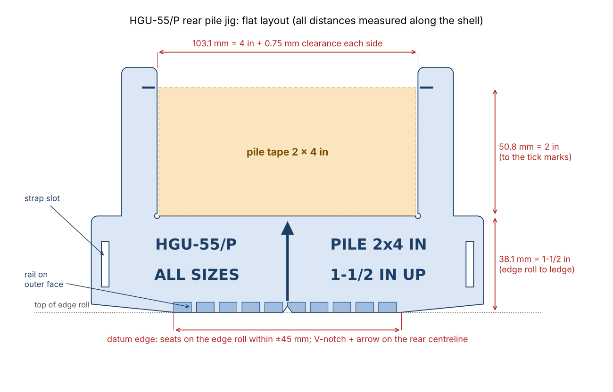

# HGU-55/P battery pack Velcro jig

3D-printable jigs for the non-ejection low-profile battery pack on the HGU-55/P
(lightweight) helmet. The main jig puts the 2 × 4 in adhesive pile patch in the
same spot every time: centred on the back of the shell, its bottom edge
1-1/2 in above the edge roll.

Project page with a 3D viewer and downloads: `index.html` in this folder
(https://kevdogg05.github.io/hgu55-velcro-jig/ once merged).



## The parts

| File | What it does | Print |
| --- | --- | --- |
| [`hgu55-rear-pile-jig-universal.stl`](stl/hgu55-rear-pile-jig-universal.stl) | Rear 2 × 4 in pile patch. Flat and flexible; **fits Medium, Large and X-Large**. Start here. | Flat, as exported |
| [`hgu55-rear-pile-jig-M.stl`](stl/hgu55-rear-pile-jig-M.stl), [`-L`](stl/hgu55-rear-pile-jig-L.stl), [`-XL`](stl/hgu55-rear-pile-jig-XL.stl) | Same jig, pre-curved to the estimated shell of each size, so it sits on the helmet by itself | Standing on its bottom edge, as exported |
| [`hgu55-cord-pile-stencil.stl`](stl/hgu55-cord-pile-stencil.stl) | Window for the two 1 × 1-1/2 in pile patches that hold the power cord | Flat |
| [`hgu55-battery-hook-template.stl`](stl/hgu55-battery-hook-template.stl) | Centres the 3-3/4 × 2 in hook strip on the back of the battery pack | Flat |

How the rear jig works:

- **Datum edge.** The bottom edge sits on top of the edge roll. It touches only
  within about 1-3/4 in of the centreline and then rises slightly, so an edge
  roll that sweeps up toward the ears can't hold the jig high. A thicker rail
  on the outside of that edge gives it more to bear on.
- **Ledge.** The top of the band is exactly 1-1/2 in (38.1 mm) above the datum
  edge, measured along the shell. The bottom edge of the tape rests on it.
- **Posts.** The two posts are 4 in apart plus 0.75 mm clearance per side
  (103.1 mm), so the tape drops in between them. Ticks on the posts mark the top
  of a 2 in patch. Small relief holes in the bottom corners let the tape corners
  seat fully.
- **Centreline.** A V-notch in the datum edge and an arrow engraved on the band
  go on the rear centreline.
- **Strap slots.** A rubber band or strap through the slots at each end, around
  the front of the helmet, holds the jig hands-free. Painter's tape on the ends
  also works.

Every distance that places tape is measured along the surface of the shell,
the way a tape measure laid on the helmet reads. The jig is drawn flat in those
surface coordinates and, for the M/L/XL versions, wrapped onto a model of the
shell without stretching. The window stays 4 in wide and 1-1/2 in up on a
curved helmet; `generate.py` checks this to 0.01 mm.

## Which rear jig to print

**Print the universal one first.** It is 2 mm thick and bends onto the back of
any of the three shells. It doesn't stretch as it bends, so the 4 in and
1-1/2 in measured along the shell stay exact on every size.

The M, L and XL versions are already curved, so they stay put without being
held flat. Their curves come from estimates (see below): no shell measurements
for the HGU-55/P are published. They are just as thin, so they flex the last
millimetre or two onto the real shell. If one fits your helmets well, it is the
quicker tool for a shop doing many helmets.

## Using the rear jig

1. **Find the rear centreline.** Measure along the edge roll between matching
   hardware on the left and right sides of the shell. Mark the halfway point on
   the edge roll with a grease pencil or a small piece of masking tape.
2. **Seat the jig.** Set the bottom edge down on top of the edge roll, with
   the V-notch and arrow on your mark. Hold it with a strap through the slots or
   painter's tape on the ends.
3. **Apply the pile.** Cut the pile tape to 2 × 4 in. Peel the backing, set
   the bottom edge on the ledge between the posts, and lay the tape onto the
   shell. Its top edge should meet the ticks on the posts. Press it down.
4. Remove the jig and press the patch down firmly.

Prepare the surface and handle the adhesive as the T.O. directs. Check your
first install against the T.O. with a ruler before you use the jig for
production.

**Cord patches (1 × 1-1/2 in).** Hold the stencil where the T.O. puts each
patch and press the tape through the window. You can also trace the window and
apply the tape after you remove the stencil. The notches and lines on the frame
are centre marks.

**Battery pack (3-3/4 × 2 in hook).** Lay the template on the back of the pack.
Centre it so the margins of the pack showing around the frame are even, or line
the notches up with pencil marks at the pack's centre. Press the hook strip in
through the window.

## Print settings

- **Material:** PETG is best because it flexes without cracking. PLA works for
  the pre-curved jigs and the flat templates.
- **Layers and walls:** 0.2 mm layers with 3 walls/perimeters, so every 2 mm
  section prints solid. No supports for any part.
- **Universal jig and templates:** print flat, as exported. The smooth side on
  the bed is the side that touches the helmet.
- **M, L and XL jigs:** print standing on the bottom edge, as exported, with a
  5–8 mm brim. The posts lean in at most 30°, so they print without supports.
  Printing them on the datum edge also makes that edge the flattest, most
  accurate face of the part.
- **Check the print:** measure 103.1 mm between the posts and 38.1 mm from the
  bottom edge to the ledge (next to the centre notch). If they're off by more
  than about 0.5 mm, check your printer's steps/mm or X/Y compensation.

## Helmet sizes and curvature (research)

**What's published.** Gentex's operation and maintenance manual (TP0351) lists
three HGU-55/P shell sizes: **Medium, Large and X-Large**. A wearer's size comes
from head length and width (its Table 2-1). Search excerpts of the table give
these values; I couldn't open the PDF itself to confirm them:

| Size | Head length | Max head width |
| --- | --- | --- |
| Medium | 7.2–7.8 in (183–198 mm) | not in the excerpt (assumed ≈ 6.2 in) |
| Large | 7.7–8.3 in (195–211 mm) | 6.5 in (165 mm) |
| X-Large | 8.2–8.7 in (208–221 mm) | 6.8 in (173 mm) |

One reseller lists shell sizes as Medium up to 22.25 in, Large 22.25–24.75 in
and X-Large 24.75 in and above (probably head circumference). The Smithsonian
lists one HGU-55/P (size not stated) at 10 × 9-1/2 × 12 in overall, including
the visor housing.

**What isn't published.** Gentex doesn't publish the shell's outside
dimensions or curvature for any size. Every sheet and listing I found sizes the
helmet by the wearer's head, not by the shell.

**Estimate used here.** Shell = head + about 25 mm of liner, padding and shell
front and back (about 28 mm at the sides). The rear of the shell in plan view is
taken as the end of an ellipse, made 10% blunter because the back of the head is
rounder than an ellipse. The front-to-back profile of the lower back is taken
from typical head shape plus the same 25 mm.

| Size | Est. shell length × width | Horizontal radius at back (`rh`) | Vertical radius (`rv`) | Lean at edge roll |
| --- | --- | --- | --- | --- |
| M | 9.8 × 8.4 in | 100 mm (3.9 in) | 145 mm (5.7 in) | −8° |
| L | 10.3 × 8.7 in | 103 mm (4.1 in) | 150 mm (5.9 in) | −8° |
| XL | 10.7 × 9.0 in | 106 mm (4.2 in) | 155 mm (6.1 in) | −8° |

Lean −8° means the lowest inch of the back tucks in toward the nape.

**What that means for the tool.** Over the area the jig covers (about 6 in
wide by 3-3/4 in tall), adjacent sizes differ by about **1 mm** at the band and
2 mm at the post tips. Medium against X-Large is 2 mm and 4 mm. The patch size
and the 1-1/2 in offset are the same for every size. So one thin jig that bends
covers all three, and the uncertainty in the curvature estimate matters more
than the difference between sizes. That's why the universal jig is the
recommended one. A flat strip conforms well here because the back of the shell
is nearly cylindrical across the band's height.

## A pre-curved jig for your own helmets

If you want a pre-curved jig that matches your shells exactly, measure one
helmet of each size:

1. **Horizontal radius (`rh`).** Hold a steel rule level across the back of
   the shell, 1-1/2–2 in above the edge roll, touching the shell on the
   centreline. Measure the gap `g` between the rule and the shell 50 mm either
   side of the centre, and average the two sides. Then
   `rh = (50² + g²) / (2·g)`.

   | g (mm) | 10 | 11 | 12 | 12.5 | 13 | 14 | 15 |
   | --- | --- | --- | --- | --- | --- | --- | --- |
   | rh (mm) | 130 | 119 | 110 | 106 | 103 | 96 | 91 |

2. **Vertical radius (`rv`).** Hold the rule upright on the centreline,
   touching the shell about 2-1/2 in above the edge roll. Measure the gaps 40 mm
   above and below that point and average them. Then
   `rv = (40² + g²) / (2·g)`.

   | g (mm) | 4 | 5 | 5.5 | 6 | 7 |
   | --- | --- | --- | --- | --- | --- |
   | rv (mm) | 202 | 163 | 148 | 136 | 118 |

3. **Lean.** Leave it at −8 unless the lowest inch of the back is plainly
   vertical (use 0) or tucks in more (use −12 to −15).

Then run:

```bash
pip install numpy manifold3d matplotlib
python3 generate.py --only-custom --custom 104 150 -8    # rh rv lean
```

The new STL is written to `stl/`. You can also change the size table in
`generate.py` (`SIZES`) and regenerate everything.

## Regenerating

```bash
pip install numpy manifold3d matplotlib   # matplotlib only for the lettering
python3 generate.py
```

The settings at the top of `generate.py` control the tape sizes, the 1-1/2 in
offset, the clearance (`CLEARANCE`, per side), the wall thickness (`WALL`), the
post height and the datum edge. Change one and rerun to get new STLs.

## Sources

- Gentex, *HGU-55/P Operation and Maintenance Instructions with Illustrated
  Parts Breakdown*, TP0351 Rev 6:
  https://shop.gentexcorp.com/content/TP0351-Rev6.pdf (sizes, Table 2-1, head
  measuring method). Also the commercial edition:
  https://shop.gentexcorp.com/content/TP0351-Commercial55.pdf
- Gentex, HGU-55/P Fixed Wing Helmet System data sheet:
  https://shop.gentexcorp.com/content/Gentex_HGU55P_Fixed_Wing_Helmet_System.pdf
  (graphite/aramid lightweight shell, leather edge roll)
- Smithsonian National Air and Space Museum, Helmet, Flying, Type HGU-55/P:
  https://airandspace.si.edu/collection-objects/helmet-flying-type-hgu-55p-united-states-air-force/nasm_A20080402000
- Reseller shell-size ranges: https://aviationhelmets.com/product/hgu-55-p-with-pru-36-p-dual-visor/
- Tape sizes and placement: T.O. 14P3-4-151, non-ejection low-profile battery
  pack (2 × 4 in pile, 1-1/2 in above the edge roll; 3-3/4 × 2 in hook on the
  pack; two 1 × 1-1/2 in pile patches for the cord).
