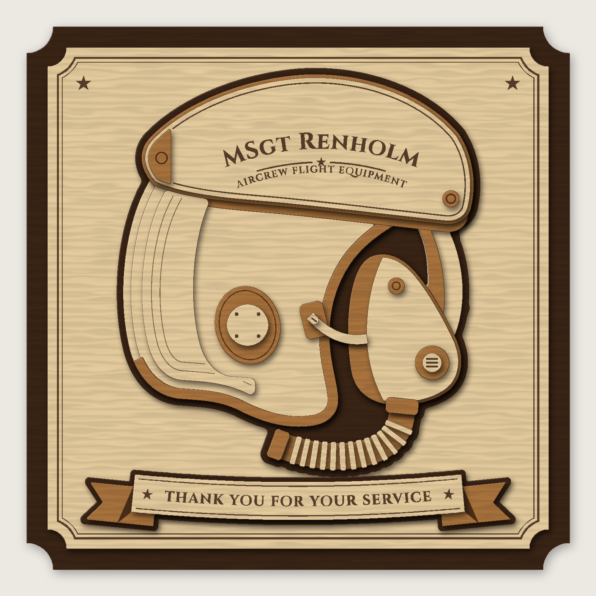

# Layered AFE Helmet Plaque: MSgt Renholm

A premium, 8-layer redesign of the "Thank You for Your Service / Aircrew Flight
Equipment" helmet plaque, set up for the **xTool S1** and **3 mm basswood plywood**.



## What's upgraded vs. the original

| Original | This version |
|---|---|
| Flat backer | Two-tone plaque: a dark walnut backer with notched corners, plus a raised natural field panel with an engraved double-line border and corner stars |
| One dark outline | Dark shadow silhouette under the helmet *and* under the banner, for a floating, shadow-box look |
| ~4 depth levels | 8 depth levels (about 24 mm deep): shell, stepped dome, crown crescent with contour lines, visor housing on a contrasting rim, lens edge, ear cup, bayonet receiver and arm, layered oxygen mask, exhalation valve |
| Printed-style text | Name and "Aircrew Flight Equipment" engraved on an arc that follows the visor housing, with a star divider. "Thank You for Your Service" sits on a separate curved ribbon banner with folded swallow-tails |
| Flat hose | Corrugated hose: 13 separate raised rings on a contrasting base, plus connector and end fitting |
| Sawtooth hanger | Hidden keyhole hanger and wall bumpers on the back, so it hangs flat and flush |

## Files

| File | Use |
|---|---|
| `files/cut-sheets/sheet-01-dark.svg` … `sheet-06-golden.svg` | **The files you send to the laser.** Each one is a 300 × 300 mm sheet (fits 12"×12" stock). |
| `files/assembly-guide.pdf` | Stack diagram, step-by-step glue-up, back hardware, sheet maps with part IDs, and laser settings |
| `files/parts-list.csv` | Every piece: ID, layer, stain colour, sheet, size |
| `files/preview.png` | Rendered mock-up |
| `files/plaque-assembled-reference.svg` | Fully assembled vector, for reference and editing only. **Don't cut this one.** |
| `generate.py` | Rebuilds everything (change the name or text, then re-run) |

### Colour code in the cut sheets

| Colour | Operation |
|---|---|
| **Black fill** (`#000000`) | Engrave: text, border, stars, hidden part IDs |
| **Blue line** (`#0000FF`) | Score: light glue guides showing exactly where the next layer goes (hidden after glue-up), plus the contour lines on the crown |
| **Red line** (`#FF0000`) | Cut |

The sheets are sorted by stain colour. You can stain or finish a whole sheet before
cutting it, which is much faster than staining 13 tiny hose rings one at a time.

| Sheet | Stain | Contents |
|---|---|---|
| 1 | Dark Walnut | Backer |
| 2 | Dark Walnut | Helmet and banner shadow outlines |
| 3 | Natural | Field panel, banner, hose rings, small caps |
| 4 | Natural | Shell, shell dome, far-side rim, mask shell |
| 5 | Natural | Visor housing (name), crown, back hanger pieces |
| 6 | Golden Pecan / Early American | Visor housing rim, edge roll, lens edge, mask seal, hose, banner tails, small fittings |

You'll need **6 sheets** of 3 mm basswood plywood (300 × 300 mm or 12" × 12").

## xTool Creative Space (XCS) workflow

1. **Import** a sheet SVG (*Import → Image/SVG*). The files are in millimetres and import at true size. Don't scale them.
2. Select objects by colour and set the processing type:
   - black fills → **Engrave**
   - blue lines → **Score**
   - red lines → **Cut**
3. Choose **3 mm basswood plywood** in the material list if you're using xTool material. Otherwise start from the settings below.
4. Use **Auto-measure** (or set thickness 3 mm), with the honeycomb panel in and air assist on.
5. Frame, then run. XCS runs engrave and score before cut by default. Keep it that way so nothing moves after cutting.

> LightBurn users: the colours map straight to separate layers (black, blue, red). Turn on *Optimization → Cut inner shapes first*.

### Starting settings for 3 mm basswood plywood

**Run a material test grid on a scrap first.** Basswood plywood varies a lot between suppliers (and in glue content).

| Operation | S1 20 W | S1 40 W |
|---|---|---|
| Engrave (fill, 0.08 mm line interval) | 30 % / 200 mm/s | 18 % / 300 mm/s |
| Score (glue guides) | 12 % / 120 mm/s / 1 pass | 6 % / 150 mm/s / 1 pass |
| Cut | 100 % / 8–10 mm/s / 1 pass | 100 % / 18–22 mm/s / 1 pass |

The glue guides only need to be a faint line you can see. If they're cutting into the wood, lower the power.

Tips:
- Put **paper transfer tape / masking tape** on the top face before cutting. It keeps the smoke haze off the natural pieces and the engraved name stays crisp. Peel it after cutting.
- If some small parts don't drop free, add a pass only to those parts rather than slowing down the whole sheet.
- The hose rings, valve cover, screw and knob are small. Leave the cut sheet in place and pick them out of the honeycomb, or tape the underside of that corner.

## Finishing

Basswood blotches with ordinary oil stain:

1. Lightly sand (220) to remove char haze from the top faces.
2. Apply a **pre-stain conditioner** or a thin shellac wash coat first, then use **gel stain**:
   - **A: Dark Walnut** – backer, shadow outlines, back hardware
   - **C: Golden Pecan / Early American** – rubber and trim parts (edge roll, visor rim, mask seal, hose, fittings, banner tails)
   - **B: Natural** – leave unstained; it gets the clear coat
3. Don't put any clear coat on gluing faces before assembly; glue holds best on stained bare wood.
4. After glue-up, spray 2 light coats of **satin or matte lacquer / Polycrylic** over the whole plaque.

Optional premium touch: wipe a little dark wax or thinned black paint into the engraved name, then wipe the surface clean. The letters will pop.

## Glue-up

Every piece has its outline lightly **scored onto the piece underneath**, set 0.8 mm
inside its edge so the line disappears after glue-up. The larger pieces also have their **part ID
engraved in a spot that gets covered** by the layer above; the small ones are easy to match by shape. Work
from the back to the front. `assembly-guide.pdf` shows each step.

| Layer | Pieces |
|---|---|
| 1 | Backer |
| 2 | Field panel |
| 3 | Helmet shadow outline, banner shadow outline |
| 4 | Shell, far-side rim, hose, banner tails |
| 5 | Shell dome, edge roll trim, visor lens edge, far-side liner, mask seal, hose rings ×13, banner |
| 6 | Crown, visor housing rim, mask shell, ear cup, bayonet receiver, hose connector and end fitting |
| 7 | Visor housing (name), ear cup cover, exhalation valve, mic boss, bayonet arm |
| 8 | Visor end cap, visor lock knob, valve cover, receiver screw |

- Use wood glue (Titebond II) sparingly, or tacky glue for the tiny parts. Too much glue squeezes out and shows on the natural wood.
- Press the big layers (1–4) under a flat board with weight for 30 min each.
- Some pieces have extra hidden material that sits under a part above them (for example, the shell extends under the visor housing). That's deliberate: it gives every raised piece something solid to glue onto, so nothing floats.

### Back hardware

1. Glue the **keyhole spacer** (long rounded pocket) to the back, centred left-to-right, about 20 mm below the top edge.
2. Glue the **keyhole plate** over it, with the wide hole at the bottom.
3. Stack the 4 bumper discs into 2 pairs and glue one pair in each bottom corner, about 20 mm in from the edges.
4. Hang it on a #8 pan-head screw left about 6 mm proud of the wall.

## Customising

Edit the top of `generate.py`:

```python
NAME = "MSgt Renholm"
SUBTITLE = "Aircrew Flight Equipment"
BANNER = "Thank You for Your Service"
```

Then run:

```bash
pip install shapely uharfbuzz numpy pillow
python3 generate.py
```

The text, glue guides, nesting, preview and guide all rebuild themselves. A
longer name may need a smaller size: the `8.6` in the `name_geo = text_arc(...)` line
is the capital-letter height in mm.

Font: [Cinzel](https://github.com/NDISCOVER/Cinzel) (SIL Open Font License, see `fonts/OFL.txt`).
The text is already converted to outlines in the SVGs, so you don't need the font installed to cut.
