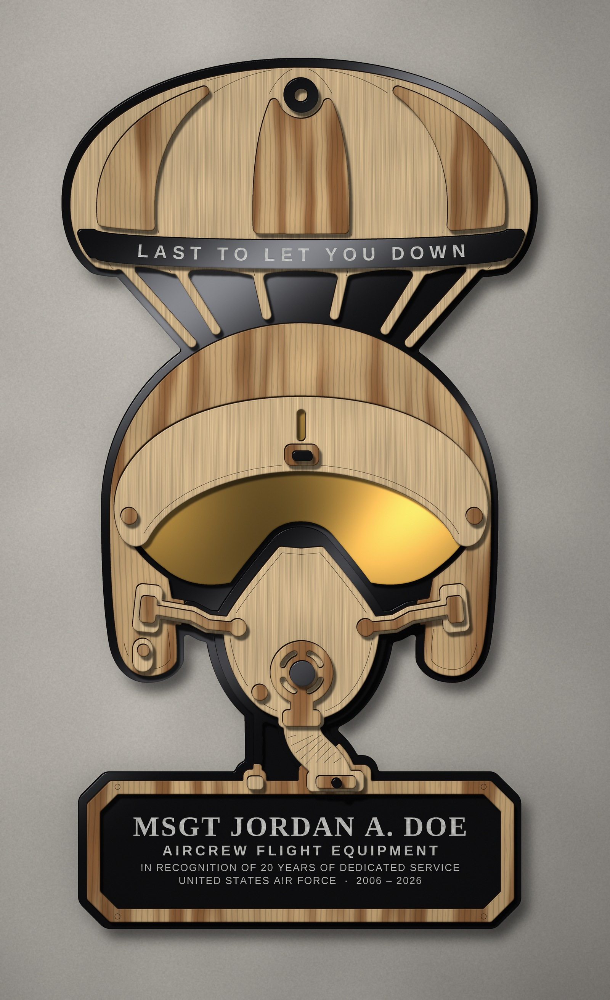
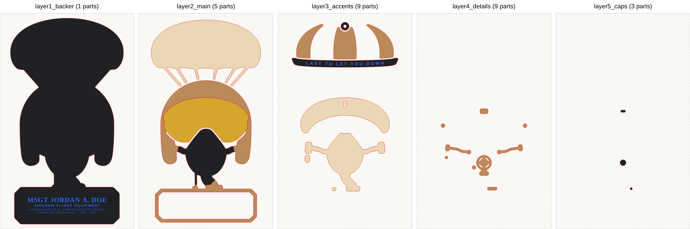

# AFE retirement plaque: "Last to Let You Down"

A 5-level laser-cut retirement plaque for an Aircrew Flight Equipment (AFE) technician. It is built around the AFE motto. A parachute canopy, the gear AFE packs, carries **LAST TO LET YOU DOWN** on its skirt band. The canopy's suspension lines run down behind the HGU-55/P helmet and MBU-20/P mask from [the helmet plaque](../hgu55-mbu20-plaque/), above a retirement nameplate.



The pictures are computer renders made from the cut file; they are not photos. Each layer is 3 mm high and the plaque stands 4 mm off the wall. The renders include ray-marched shadows, charred wood edges, polished acrylic edges, procedural hickory and basswood grain, gloss and mirror reflections, and frosted engraving. The name and dates are placeholder text.

| | |
|---|---|
| Cut file | `afe_retirement_plaque.svg` |
| Finished size | 219.5 × 401.3 mm (8.6 × 15.8 in), 15 mm of relief |
| Units | mm (`viewBox` 1 unit = 1 mm) |
| Colours | `#FF0000` stroke = cut · `#0000FF` fill = engrave · `#000000` stroke = optional score |

## Materials

| Material (all 3 mm) | Used for | Sheet |
|---|---|---|
| Gloss **black acrylic** (opaque) | Backer, canopy skirt band and apex vent, mask facepiece (the black rubber seal), hose, mic cord, knob and valve caps | 12 × 24 in. The 220 × 401 mm backer needs the length; everything else fits in the offcut. |
| **Gold mirror acrylic** | Visor lens | One 167 × 87 mm piece |
| **Hickory** | Helmet shell, nameplate frame, 3 canopy gores, knob, friction screws, valve, bayonet straps, connectors | 12 × 12 in |
| **Basswood** | Canopy with its 6 suspension lines (one part), visor housing, mask hard shell, bayonet receivers, corrugated hose | 12 × 12 in |

Using only one acrylic: cut the visor from the black acrylic for a smoked visor.

## Layers



| Level | Group | Parts |
|---|---|---|
| 1 | `layer1_backer` | Black acrylic backer. The nameplate text and the 4 mm reveal are on this layer. |
| 2 | `layer2_main` | Basswood canopy with its lines; hickory helmet shell and nameplate frame; gold visor; black acrylic mask seal, strap bridges, hose and mic cord |
| 3 | `layer3_accents` | 3 hickory gores; black motto band and apex vent ring; basswood visor housing, mask hard shell with straps and receivers, hose, comm boss, cord plug |
| 4 | `layer4_details` | Hickory visor knob, friction screws, valve with grille, bayonet straps, pivots, grommets, terminal |
| 5 | `layer5_caps` | Black acrylic knob grip, valve cap and latch |

Each layer is drawn in its own 260 × 420 mm window, and the windows are 270 mm apart along X. A part sits at the same position inside every window, so shifting layer *n* left by 270 × (*n*−1) mm puts it in its stacked position.

Inside a layer, parts are grouped by material in `layerN_..._<material>_cut`, so you can cut one sheet type at a time. Select those groups across all five windows and nest them on the sheet. The black score lines then show where each part goes, as described next.

Two kinds of black score lines:

* `*_score_align`: glue guides. Each traces the outline of the part that goes on top, set 1.5 mm inside it, so the part hides the line.
* `*_score_detail`: decorative lines: the canopy seams converging on the apex, the helmet edge trim, the visor-housing lip, the mask rim, the hose corrugations and the nameplate rivets.

Disable the black layer to skip all of them.

## Engraving

The blue-filled groups are raster engrave jobs. The text is already converted to outlines, so no fonts are needed.

* `layer1_backer_engrave`: the name block on the black backer. The window inside the hickory frame is 185 × 53 mm. Black acrylic engraves to a frosted white.
* `layer3_accents_engrave`: "LAST TO LET YOU DOWN" on the black skirt band.

Placeholder text: replace it with your own before engraving. You can edit `NAME_LINES` / `MOTTO` in `src/afe_plaque.py` and re-run, or retype it in your laser software, keeping it inside the window. Engrave with the acrylic's masking removed, and before glue-up.

## Fabrication checks

`src/verify_afe.py` reads the exported SVG back in with an independent path parser and re-checks every part. All five layers pass:

* No material narrower than 3.5 mm in any part. The narrowest measured spot is 3.6 mm, at the strap joints; most features are 4.3 mm or more.
* No gap or slot narrower than 2.6 mm. The narrowest measured gap is 2.7 mm.
* Parts in the same layer never overlap beyond the 0.05 mm curve-fit tolerance. Where two materials meet, they butt together with square corners.
* Every part sits on the level below it. The one exception is the visor housing: it crosses the round ends of the two visor-edge slots (≈8 mm² each) and is glued on both sides.

Cut parameters are not included; run a test cut on each material first. Acrylic cuts cleanest with air assist low and the masking on.

## Assembly

1. Engrave the backer and the band.
2. Glue Layer 2 onto the backer along its guides. Use thin CA or epoxy where wood meets acrylic, and wood glue where wood meets wood.
3. Glue Layers 3, 4 and 5 onto their scored guides, in that order.
4. Wipe the acrylic with a microfiber cloth; finish the wood with a clear satin coat if you like (mask the acrylic first).
5. Hang it with a sawtooth hanger on the back of the backer. The renders assume about 4 mm of standoff.

## Regenerating

The design reuses the helmet library in `../hgu55-mbu20-plaque/src` (Python 3, `shapely`, `numpy`, `fonttools`, `scipy`, `pillow`, `svgpathtools`):

```sh
cd src
python3 afe_plaque.py --svg ../afe_retirement_plaque.svg   # cut file + fabrication checks
python3 verify_afe.py ../afe_retirement_plaque.svg         # independent re-check of the file
python3 render_afe.py ../render_afe_plaque.jpg             # photoreal render (a few minutes)
python3 preview_afe.py assembled.svg layers.svg            # flat material previews
```

* `SCALE` in `afe_plaque.py` sets the size. At 0.88 the measured minimums are 3.6 mm of material and 2.7 mm
  gaps; below about 0.86 they drop under the 3.5 mm / 2.6 mm limits.
* `HICKORY_GORES` picks which gores are hickory.
* `NAMEPLATE` sets the nameplate box.
