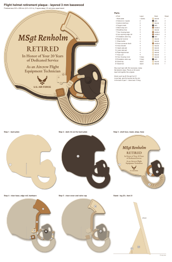

# Flight helmet retirement plaque (layered 3 mm basswood)

A layered laser-cut plaque of an aircrew flight helmet with oxygen mask and
hose, engraved for **MSgt Renholm's** retirement.



| File | What it is |
| --- | --- |
| `helmet-plaque-cut.svg` | The laser file: all 21 parts on four 12 × 12 in sheets |
| `sheets/sheet-1-natural.svg` … `sheet-4-medium.svg` | The same parts, one sheet per file |
| `helmet-plaque-preview.svg` | Assembled preview, parts list and step-by-step glue-up |
| `generate.py` | Builds all of the above (edit it to change the wording) |

**Finished size:** 216 × 236 mm (8.5 × 9.3 in), 5 layers (15 mm) deep, on an
easel stand that leans it back 15°.

## Colour key

| Colour | Operation |
| --- | --- |
| Black fill | Engrave (lettering, emblem, hose ribs, visor knob) |
| Blue `#0000FF` | Score (border line, visor track, rivets, grip ribs) |
| Red `#FF0000` | Cut |
| Green `#00A000` | Guides only (sheet outlines, part numbers). Set to **no output** |

Units are millimetres and all lettering is already converted to outlines, so
no fonts are needed to cut it. Run engrave, then score, then cut. Don't
scale the file: the stand slot and tab are sized for 3 mm stock.

## Material

| Sheet | Stain | Parts |
| --- | --- | --- |
| 1 | Natural | 1 back plate, 10, 11 and 13–17 small hardware, 21 stand foot |
| 2 | Natural | 3 shell face (engraved), 6 hose, 18 visor cover, 20 stand leg |
| 3 | Dark (dark walnut / ebony) | 2 helmet rim, 4 mask, 9 valve ring, 19 valve cap |
| 4 | Medium (golden oak / early american) | 5 strap, 7 visor base, 8 edge roll, 12 hose block (uses about 172 × 101 mm, so a scrap works) |

Stain after cutting and before gluing. Gel stain or stain markers warp thin
basswood less than water-based stain. Leave the engraved parts natural and
clear-coat everything at the end.

## Assembly

The preview file shows each step. Layers stack back to front:

1. **Back plate (1)**: natural; its outline shows as a light border.
2. **Helmet rim (2)**: dark; it shows as the dark band along the bottom
   edge and face opening, and as an outline around the mask and hose.
3. **Shell face (3), mask (4), strap (5), hose (6)**: these fit together
   like a jigsaw.
4. **Visor base (7), edge roll (8), valve ring (9), receiver (10),
   buckle (11), hose block (12), bracket (13), grip pads (14, 15),
   bayonet tab (16), hose cuff (17)**
5. **Visor cover (18), valve cap (19)**

**Stand:** slide leg 20 and foot 21 together at their slots (cross-lap),
then glue the tab on the leg's front edge into the slot in the back of the
back plate. The rim layer covers the slot, so it can't be seen from the
front.

## Changing the wording

Edit the personalisation block at the top of `generate.py`, then run:

```
pip install shapely fonttools uharfbuzz skia-pathops
python3 generate.py
```

The lettering is set in Alegreya SemiBold Italic (name), EB Garamond Medium
(title and body) and Arimo Bold ("U.S. AIR FORCE"). All three are SIL Open
Font License fonts and are included in `fonts/`.

The wings emblem is a stylised redraw, not the official artwork. The Air
Force symbol is a registered trademark. A personal gift is fine, but selling
plaques that carry it needs a license from the Air Force trademark licensing
program. Set `INCLUDE_EMBLEM = False` to leave it off, or `BRANCH = ""` to drop
the "U.S. AIR FORCE" line.
