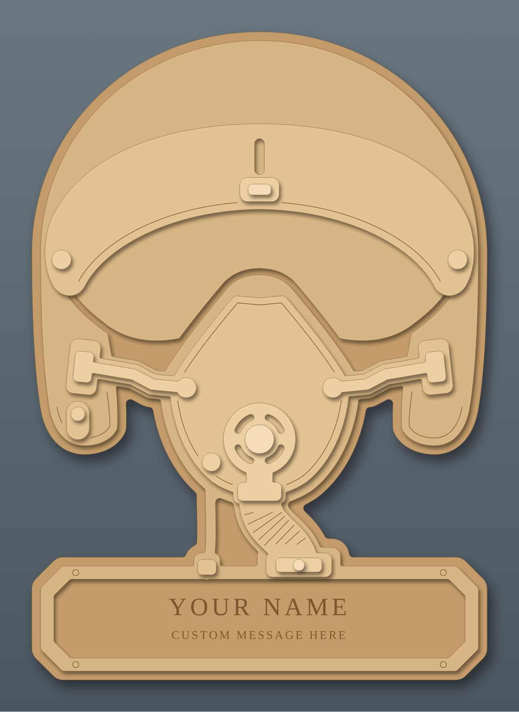
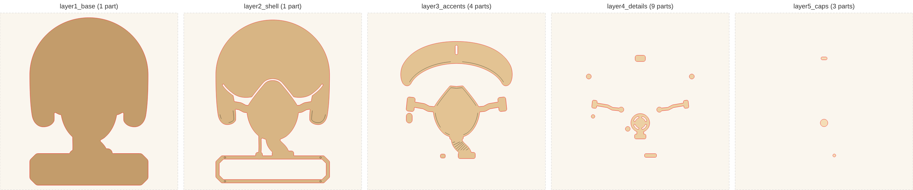
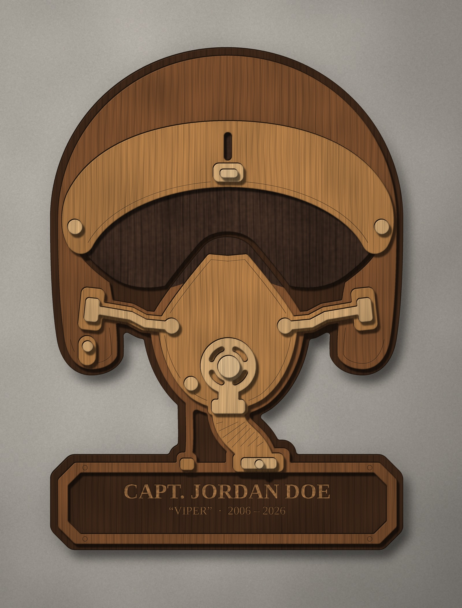

# HGU-55/P + MBU-20/P stacked basswood plaque

A 5-layer laser-cut plaque of the HGU-55/P flight helmet (visor down) with the MBU-20/P oxygen mask, front view, with a blank nameplate for engraving.



| | |
|---|---|
| Cut file | `hgu55_mbu20_plaque.svg` |
| Material | 3 mm basswood, 5 layers (15 mm of relief) |
| Finished size | 199.7 × 284.2 mm (7.86 × 11.19 in) |
| Sheet | each layer fits a 300 × 300 mm sheet (also fits 12 × 12 in) |
| Units | mm (`viewBox` 1 unit = 1 mm, `width`/`height` in mm) |
| Colours | `#FF0000` = cut through · `#000000` = optional score |

## Layers



Each layer sits in its own 300 × 300 mm window. The windows are 310 mm apart along X, and the art is at the same position inside every window. So shifting a layer left by `310 × (n−1)` mm puts it exactly in its stacked position.

| Group id | Parts | Contents |
|---|---|---|
| `layer1_base` | 1 | Solid backdrop: the whole silhouette plus a 4 mm reveal (shadow line) and the nameplate tablet. **No marks in any visible area. This is the engraving surface.** |
| `layer2_shell` | 1 | Helmet shell and visor lens, MBU-20/P silicone facepiece, bayonet strap underlays, hose, mic cord, nameplate frame. One piece. The cheek openings, the 3 mm visor-edge shadow slot and the gap around the mask nose are cut out, so the base shows through. |
| `layer3_accents` | 4 | Visor housing (with the knob track slot), mask hard shell with strap arms, bayonet receiver brackets, hose cuff, corrugated hose and terminal block (all one part), comm-lead boss, mic-cord plug |
| `layer4_details` | 9 | Visor knob, 2 visor friction screws, valve assembly (4-port grille, neck and hose collar), 2 offset bayonet straps (each with a bayonet tip and a mask pivot), mic-cord entry grommet, hose terminal, comm-lead entry |
| `layer5_caps` | 3 | Knob grip, valve centre cap, terminal latch |

Each layer has up to three sub-groups:

* `*_cut`: red cut paths. Each part is one `<path>`, with its holes as extra subpaths.
* `*_score_detail`: black decorative scores: the shell's edge roll, the visor-housing lip, the mask hard-shell rim, the hose corrugations and the nameplate rivets.
* `*_score_align`: black glue guides. Each one traces the outline of the piece that goes on top, set 1.5 mm inside it, so the glued piece hides it. Layer 2 has no guide; the even 4 mm reveal around it is the guide.

To cut a layer with no scoring, delete or disable its `*_score_*` sub-groups (or switch the black layer off in LightBurn).

## Engraving zone

The exposed base inside the nameplate frame is about **180 × 35 mm**. In the cut file it is at x 59.8–240.2, y 247.9–282.5 mm (Layer 1 window), and the same numbers are in a comment inside `layer1_base`. Keep text at least 3 mm inside that window. That fits two lines, for example a 12 mm name and a 6 mm line under it.

Engrave the base **before** glue-up, with its exact position kept so the text registers.

Optional: the visor lens on Layer 2 is another large flat area. You can put a call sign there, or lightly raster it to give a smoked-visor look.

## Fabrication checks

The checks run in `src/verify_svg.py`, which reads the exported SVG back in with an independent path parser:

* No material narrower than 3.5 mm on any layer. Measured minimums: 4.3 mm on Layer 4 (valve grille ring), 4.4 mm on Layer 2 (mic cord), 4.6 mm on Layer 3 and 4.8 mm on Layer 5.
* No gap or slot narrower than 2.6 mm. The design gap is 2.9 mm after scaling.
* Every part on layers 2–5 sits fully on the layer below it. The one exception is the visor housing: it crosses the round ends of the two visor-edge slots (≈8 mm² each) and is glued on both sides.
* No parts overlap within a layer. Every interior cutout is a clean closed ring, and no island drops out.
* The Bézier curves stay within 0.05 mm of the exact geometry, well under the kerf.

## Suggested process

1. Do a test cut first. For 3 mm basswood the usual starting points are about 10–15 mm/s at 80–100 % on a 40–60 W CO₂ tube, or 3–5 passes on a 10–20 W diode. Score at about 25 % of cut power.
2. Cut Layer 1. Engrave the nameplate window while the sheet is still in place.
3. Glue Layer 2 on, centring it so the 4 mm reveal is even all round. Then glue Layers 3, 4 and 5 onto their scored guide outlines. Use wood glue or thin CA, and press each layer flat.
4. Finish (optional): stain the base a shade darker before glue-up, so the reveal, the cheek openings and the visor-edge slots read as shadow.

## Stained render

These are computer renders made from the cut geometry; they are not photos. Each layer is 3 mm high and the plaque stands 4 mm off the wall on its hanger. The renders include ray-marched shadows, charred laser edges, procedural basswood grain and the stain colours below. The name is sample text.



| Layer | Stain used in the render |
|---|---|
| 1 Base | Dark walnut. Engrave after staining, so the burn shows lighter wood. |
| 2 Shell, mask body, frame | Early American (medium brown) |
| 3 Housing, hard shell, receivers | Golden oak |
| 4 Knob, valve, straps | Natural, amber satin poly |
| 5 Caps | Natural |

The "smoked visor" in the top render is an optional raster engrave of the Layer 2 lens area. Without it the lens takes the shell stain, as in `render_stained_plain.jpg`. `render_stained_detail.jpg` is a full-resolution close-up of the mask. Re-render with `python3 render_photo.py out.jpg [--visor] [--detail closeup.jpg]`. The stain colours are the `STAINS` table at the top of `render_photo.py`.

## Regenerating / tweaking

The design is parametric (Python 3, `shapely`, `numpy`):

```sh
pip install shapely numpy svgpathtools
cd src
python3 export.py --svg ../hgu55_mbu20_plaque.svg   # cut file + checks
python3 verify_svg.py ../hgu55_mbu20_plaque.svg     # independent re-check of the file
python3 preview.py assembled.svg sheet.svg          # preview SVGs (render to PNG with any browser)
```

* `SCALE` in `export.py` sets the overall size. Re-run the checks after changing it.
* `P['reveal']` (base shadow line) and `P['gap']` (panel gaps) are in `plaque.py`.
