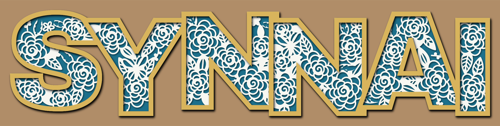
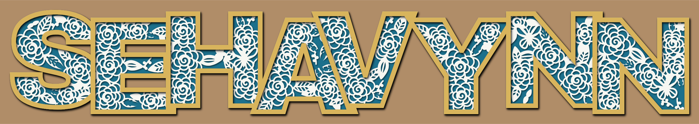

# Layered floral name signs: SYNNAI & SEHAVYNN

These are 3D shadow-box style name cut files: a blue backing, a white papercut
layer with roses, leaves and butterflies, and a gold letter frame on top.





## Files

Each name folder has the same set of files:

| File | What it is |
| --- | --- |
| `NAME-layer1-base-blue.svg` | Bottom layer: the solid backing |
| `NAME-layer2-floral-white.svg` | Middle layer: the floral papercut. It is one connected piece. |
| `NAME-layer3-frame-gold.svg` | Top layer: the letter outlines. Cut 2 or 3 and stack them for depth. |
| `NAME-all-layers.svg` | All three layers in one file, stacked and colour-coded (good for Cricut Design Space) |
| `NAME-preview.svg` / `.png` | Mock-up of the finished piece. It is for viewing only, not for cutting. |

| Name | Finished size | Letter height |
| --- | --- | --- |
| SYNNAI | 389 × 89 mm (15.3 × 3.5 in) | 75 mm (about 3 in) |
| SEHAVYNN | 555 × 89 mm (21.9 × 3.5 in) | 75 mm (about 3 in) |

All three layers have exactly the same outer outline, so they line up edge to
edge when you stack them.

## Cutting

**Cricut:** upload `NAME-all-layers.svg`. It imports as three layers at the
correct size. If Design Space shows a different width, set it to the width above.
SEHAVYNN needs a 12 × 24 in mat. For the floral layer, use 65–80 lb cardstock
and the *Intricate Cut* setting. Heavier cardstock or chipboard works well for
the base and frame.

**Laser:** import the three single-layer files and set everything to *cut*.
3 mm (1/8 in) wood or MDF works for the base and frame. The floral lines are
1.2 mm wide, so cut that layer from thin material (cardstock, 1.5 mm ply or
veneer), or regenerate it larger (see below).

Don't scale these files down by more than about 10%. Smaller than that, the
floral lines become too thin to cut cleanly.

## Assembly

1. Lay down the **base** (blue).
2. Glue the **floral** layer (white) on top, matching the outer edges.
3. Glue the **frame** (gold) on top. For the raised look in the photo, stack 2–3
   frame copies, or put foam tape under the top one.
4. The frame file also has a small separate piece: the outline around the
   triangle hole of the **A**. Glue it around that hole.

The colours are only labels, so you can swap in any cardstock or paint colours
you like.

## Making another name or size

```sh
pip install shapely fonttools
python3 generate.py SYNNAI SEHAVYNN            # rebuild these two
python3 generate.py OLIVIA --cap 100           # any name, 100 mm tall letters
python3 generate.py SYNNAI --seed 12           # a different flower arrangement
```

`--cap` sets the letter height in mm. Line widths stay at 1.2 mm whatever the
size, so larger signs get more open, chunkier cut-outs. The font is
[Archivo Black](https://fonts.google.com/specimen/Archivo+Black) (SIL Open Font
License). The script downloads it automatically the first time it runs.
