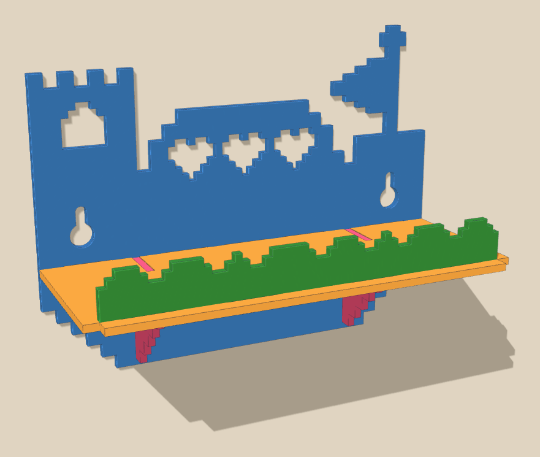
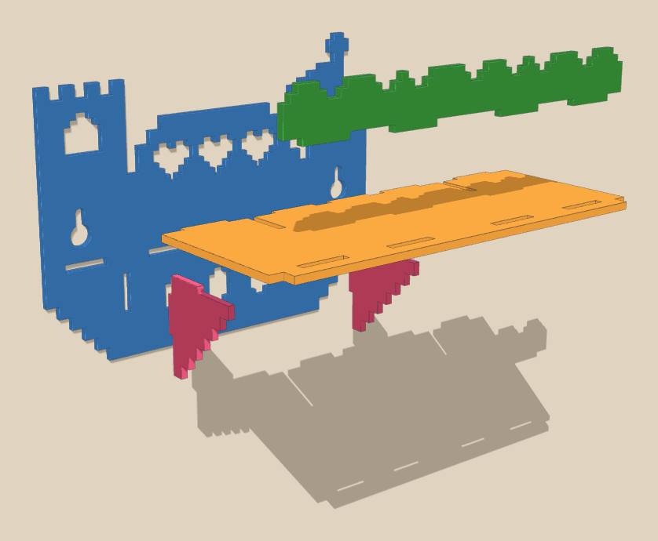

# Level-Up Toy Shelf

A wall shelf that looks like a level from a pixel video game. It has a castle
tower, a hill with three heart "lives", a goal flag, a grass rail along the
front, coin cut-outs under the shelf and stair-block brackets.



**Print file: [`level-up-shelf.svg`](level-up-shelf.svg).** It holds 5 flat parts, each exactly 3 mm thick.

| | |
| --- | --- |
| Assembled size | 180 mm wide, 138 mm tall, 75 mm deep |
| Shelf space | 180 × 63 mm behind the grass rail, open above |
| Filament | about 80 g of PLA (estimate; your slicer has the real number) |
| Hardware | 2 screws (#8 or M4 pan head) + wall anchors |

## Why it prints fast

- Every part is a flat 3 mm plate, so there are no supports, overhangs or
  bridges. That's about 11 layers at 0.28 mm.
- It fits on one plate on a 256 mm bed (Bambu Lab A1, P1S, X1C). On a 220 mm
  bed, print the back panel by itself first, then the other four parts.

## Print it

1. Import `level-up-shelf.svg` into Bambu Studio, OrcaSlicer or PrusaSlicer
   (drag it onto the plate, or use File › Import).
2. Set the depth (height) to **exactly 3 mm**. The slots are made for 3 mm
   parts. The back panel should come in 180 mm wide; if it doesn't, scale it
   until it does.
3. Split it into separate objects and let the slicer arrange them.
4. Settings: 0.28 mm "draft" layers (0.2 mm works too), 2 walls, 15 % infill,
   no supports, no brim.

Fun colour idea: a blue panel, an orange shelf, a green rail and pink
brackets. Or print the whole thing in one colour.

**Laser cutter:** you can also cut the same file from 3 mm (1/8") plywood or
acrylic. Set every shape to "cut".

## Build it



Lay the back panel face-up on a table, then:

1. Push the two stair brackets into the two upright slots. The stairs face
   the bottom (floating-island end) of the panel, and the small tab on the
   bracket's top edge sits right against the panel.
2. Slide the shelf down along the top of the brackets. Its back tabs drop into
   the row of slots, and its two open notches go over the brackets' small tabs.
3. Push the grass rail into the four slots along the front of the shelf.
4. A drop of super glue in each joint makes it permanent. That's a job for a
   grown-up.

## Hang it

The two keyholes are 144 mm apart, so put two screws in the wall 144 mm apart
and level. Use wall anchors if it's drywall. Leave a gap of about 4 mm between
the wall and the underside of each screw head. Fit the round holes over the
heads, slide the shelf down, then snug the screws.

It's made for light toys like figures, small LEGO builds and cars. It's not a
step or a handle.

## Change it

`make_shelf.py` draws the SVG and checks that every tab lands in its slot.
Edit the numbers at the top and run it again:

```bash
pip install shapely
python3 make_shelf.py
```

- Joints too tight or too loose? Change `CLR` (the gap in each slot, 0.4 mm now).
- Using a different thickness? Change `T`.

Ideas: print one for each kid in their own colours, or hang a few at
different heights so the wall looks like platforms in a game.
