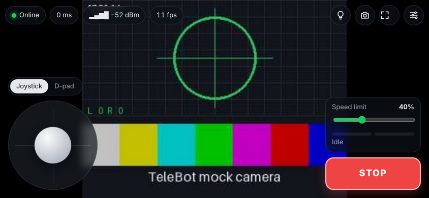
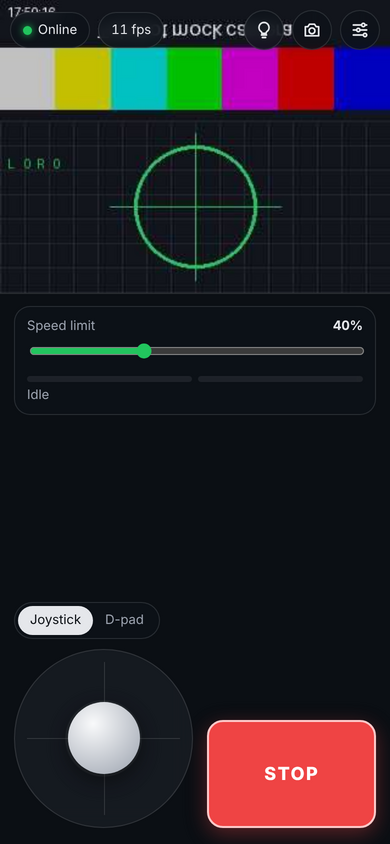
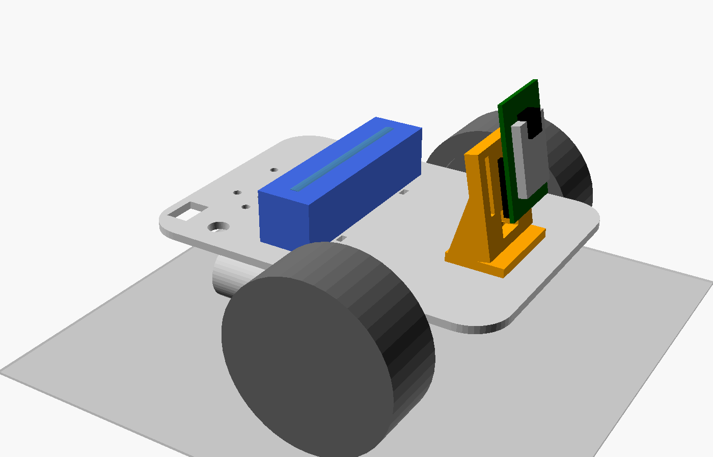
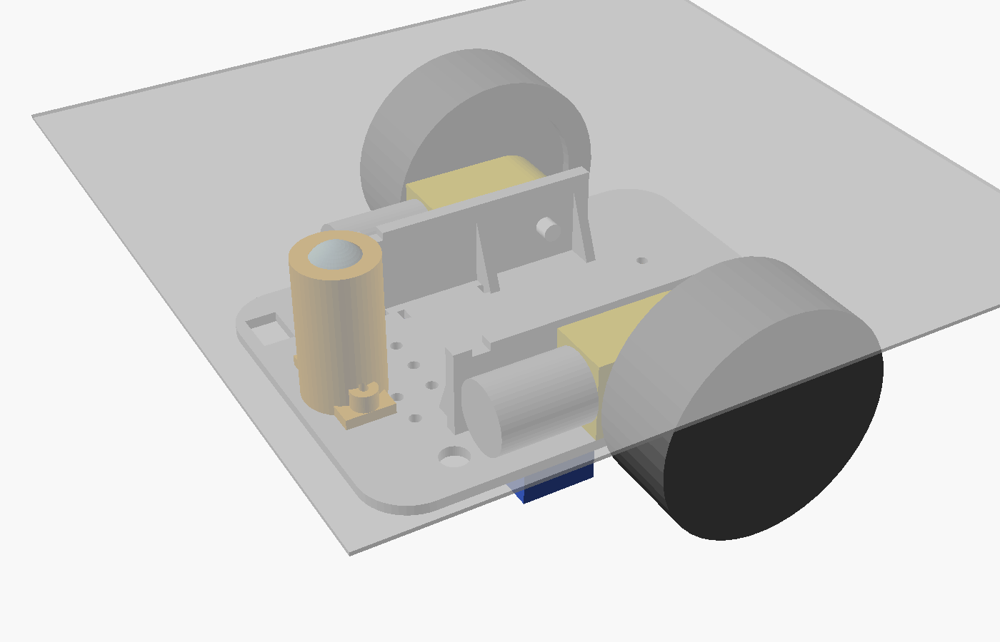

# TeleBot architecture

A two-wheel telepresence robot for about $24 in parts ($30-35 with shipping and
spares), driven from a phone browser over Wi-Fi with live video. No app, no
cloud: the robot serves its own dashboard.



## Contents

1. [Requirements](#1-requirements)
2. [System overview](#2-system-overview)
3. [Component choices](#3-component-choices)
4. [Power design](#4-power-design)
5. [ESP32-CAM pinout and GPIO map](#5-esp32-cam-pinout-and-gpio-map)
6. [Wiring diagram](#6-wiring-diagram)
7. [Firmware](#7-firmware)
8. [Control protocol](#8-control-protocol)
9. [Web dashboard](#9-web-dashboard)
10. [Chassis](#10-chassis)
11. [Build, flash and first run](#11-build-flash-and-first-run)
12. [Troubleshooting](#12-troubleshooting)
13. [Security](#13-security)
14. [Raspberry Pi Zero 2 W variant](#14-raspberry-pi-zero-2-w-variant)

---

## 1. Requirements

| # | Requirement | How it is met |
|---|---|---|
| R1 | Parts cost $30-40 | $23.78 of required parts in [bom.csv](bom.csv); the rest of the budget covers shipping and spares |
| R2 | Controlled from a phone, no app install | Dashboard served by the robot at `http://telebot.local/`, works in any modern mobile browser |
| R3 | Live video | OV2640 MJPEG stream, 320x240 to 800x600, up to 20 fps |
| R4 | Low-latency driving | WebSocket text commands at 20 Hz, Nagle disabled, Wi-Fi modem sleep disabled, video on a separate server so frames never queue ahead of commands |
| R5 | Forward, reverse, spin left, spin right, stop | D-pad and STOP buttons map to `move ...` / `stop`; joystick and keyboard add proportional arcs |
| R6 | Safe when the link drops | 500 ms command watchdog, stop on driver disconnect, stop when the page is hidden, driver held asleep during boot and OTA |
| R7 | Works without a home network | Falls back to its own access point (`TeleBot-XXXX`, 192.168.4.1) |
| R8 | Printable chassis | Three OpenSCAD parts, no supports, about 95 g of filament |

## 2. System overview

```
 ┌──────────── Phone / laptop browser ────────────┐
 │  web/index.html (served by the robot)          │
 │   joystick · D-pad · keys · gamepad            │
 │   video          settings / telemetry     │
 └───────┬────────────────────────┬───────────────┘
         │ ws://robot/ws          │ http://robot:81/stream
         │ commands 20 Hz ↑       │ MJPEG frames ↓
         │ state, telemetry ↓     │
 ════════╪═══════ 2.4 GHz Wi-Fi (home network or the robot's own AP) ═══════
         │                        │
 ┌───────┴────────────────────────┴─────────────── ESP32-CAM ──────────────┐
 │ AsyncWebServer :80 (AsyncTCP task)    esp_http_server :81 (httpd task)  │
 │   GET /         gzipped dashboard       GET /stream   multipart JPEG    │
 │   GET /status   state JSON              GET /capture  one JPEG          │
 │   WS  /ws  ─► parseCommand ─► target   ▲                                │
 │                    (portMUX)    │       │ esp_camera_fb_get()            │
 │ loop() @100 Hz: failsafe ─► ramp ─► LEDC PWM        OV2640 (DVP, PSRAM)  │
 │ OTA · mDNS · NVS settings · status LED                                  │
 └──────────────┬───────────────────────────────────────────────────────────┘
                │ GPIO 12 13 14 15 (PWM)   GPIO 2 (nSLEEP)
        ┌───────┴────────┐
        │ DRV8833        │──► left TT motor ──► 65 mm wheel
        │ dual H-bridge  │──► right TT motor ─► 65 mm wheel
        └───────┬────────┘
                │ 5 V
 18650 ─► IP5306 (charge + protect + boost 5 V) ─► switch ─► 5 V rail (ESP32-CAM, DRV8833)
```

## 3. Component choices

### Controller: ESP32-CAM (chosen) vs Raspberry Pi Zero 2 W

| | ESP32-CAM (AI-Thinker) | Raspberry Pi Zero 2 W |
|---|---|---|
| Price with camera | ~$7.50 incl. USB programmer | ~$15 board + ~$10 camera + SD card |
| Boot to drivable | ~2 s | 20-40 s |
| Power | ~1 W streaming | ~1.5-3 W |
| Video | MJPEG, 800x600 max at useful frame rates | H.264/WebRTC, 720p+, lower bandwidth |
| Free GPIO | 6 (2, 4, 12-15) once the SD slot is unused | plenty |
| Fits $30-40 total | yes, with margin | only just, with no margin |

The ESP32-CAM wins on cost, power and boot time. The Pi is the upgrade path for
better video ([section 14](#14-raspberry-pi-zero-2-w-variant)).

### Motor driver: DRV8833 (chosen) vs L298N

| | DRV8833 | L298N module |
|---|---|---|
| Voltage drop at 0.5 A | ~0.2 V (MOSFET) | 2-3 V (bipolar) |
| Motor voltage on a 5 V rail | ~4.8 V | ~2.5 V: TT motors barely move |
| Logic inputs | internal pull-downs: keeps GPIO 12 low at boot | none |
| Size / price | 18 x 16 mm / ~$1.20 | 43 x 43 mm / ~$2 |

The firmware drives either (L298N: fit the ENA/ENB jumpers, wire IN1-IN4 like
DRV8833 IN1-IN4, leave nSLEEP unconnected), but on a single-cell 5 V system
only the DRV8833 leaves the motors enough voltage.

### Drive: TT gear motors, differential drive

Two 1:48 TT motors with 65 mm wheels and a rear ball caster. At 5 V they turn
about 160 rpm, so top speed is about 0.55 m/s; the dashboard's default 70 %
speed limit gives a comfortable indoor ~0.35 m/s.

## 4. Power design

```
 18650 cell        IP5306 module                     5 V rail
 3.0-4.2 V  ─────► B+  ┌──────────────────┐  5V ──► SW1 ──┬───────────────┬───────────────┐
            ─────► B-  │ charger 1 A      │                │               │               │
                       │ protection (BMS) │  GND ──────────┼───────┬───────┼───────┬───────┤
 USB-C 5 V  ─────────► │ boost 5 V 2.1 A  │                │       │       │       │       │
 (charging)            └──────────────────┘             ESP32-CAM  C1    DRV8833  C2     │
                                                          5V/GND 1000µF  VCC/GND 100nF   │
                                                                                         │
                                                         motors: 100 nF across each motor's terminals
```

**Why one cell and a boost converter?** It is the cheapest safe arrangement:
one cell, one combined charge/protect/boost board, USB-C charging, and a stable
5 V rail for both the ESP32-CAM's on-board 3.3 V regulator and the motors (TT
motors are rated 3-6 V). Two cells in series would give the motors more
voltage but need a balance charger and a buck converter, which costs more.

### Current budget (5 V rail, estimates)

| Load | Typical | Peak |
|---|---|---|
| ESP32-CAM, Wi-Fi + camera streaming | 180 mA | 350 mA (TX bursts) |
| Flash LED at the 63 % cap (`LIGHT_MAX_DUTY 160`) | 0 | 130 mA |
| 2 x TT motor driving on a hard floor | 2 x 200 mA | 2 x 700 mA at start or stall |
| **Total** | **~0.6 A** | **~1.8 A** |

The IP5306 is rated 2.1 A, so peaks fit. The firmware's acceleration ramp
(0 to full in ~210 ms) keeps motor inrush well under the stall figure.

### Battery life (estimates, 3000 mAh cell ≈ 10.8 Wh, ~88 % boost efficiency)

| Activity | 5 V load | Runtime |
|---|---|---|
| Streaming, parked | ~1 W | ~9 h |
| Streaming and driving continuously | ~3 W | ~3 h |
| Typical mixed use | | 4-6 h |

### Brownout prevention

The ESP32-CAM is notorious for resetting ("Brownout detector was triggered")
when its supply dips. In order of importance:

1. **C1, 1000 µF** across 5V/GND right at the ESP32-CAM pins.
2. Short, thick (22 AWG) power wiring; the logic GND and motor GND meet at the
   5 V rail, not through a thin Dupont wire.
3. **100 nF** across each motor's terminals (soldered at the motor) to keep
   brush noise out of the rail.
4. The firmware's soft-start ramp (`RAMP_UP_PER_TICK`).
5. Only as a last resort: build with `-DDISABLE_BROWNOUT_DETECTOR=1`. This hides
   the symptom and risks flash corruption on a real undervoltage.

## 5. ESP32-CAM pinout and GPIO map

AI-Thinker ESP32-CAM, viewed from the camera side with the antenna at the top.
Each row is one physical pair of pins. Labels are printed on the back of the
board; trust them if a clone differs.

```
                      ┌─────────────────────────────────┐
                      │  ▓▓▓▓▓▓▓▓ PCB antenna ▓▓▓▓▓▓▓▓  │
                      │      ┌───────────────────┐      │
                      │      │  ESP32-S module   │      │
                      │      │    ┌─────────┐    │      │
                      │      │    │ OV2640  │    │      │
                      │      │    │ camera  │    │      │
                      │      │    └─────────┘    │      │
                      │      └───────────────────┘      │
on-board LED only  ── │● GPIO 4                   GND ●│ ── GND
DRV8833 EEP/nSLEEP ◄─ │● GPIO 2                GPIO 1 ●│ ── U0TXD, programmer only
DRV8833 IN3 (BIN1) ◄─ │● GPIO 14               GPIO 3 ●│ ── U0RXD, programmer only
DRV8833 IN4 (BIN2) ◄─ │● GPIO 15                  VCC ●│ ── 3.3 V out, unused
DRV8833 IN2 (AIN2) ◄─ │● GPIO 13                  GND ●│ ── GND
DRV8833 IN1 (AIN1) ◄─ │● GPIO 12               GPIO 0 ●│ ── camera clock; GND only to flash
GND rail           ── │● GND                  GPIO 16 ●│ ── PSRAM, do not use
5 V rail           ── │● 5V                       3V3 ●│ ── unused
                      └─────────────────────────────────┘
```

| GPIO | Use | Boot behaviour and notes |
|---|---|---|
| 0 | Camera XCLK | Strapping pin. LOW at reset = download mode (the ESP32-CAM-MB does this for you) |
| 1 / 3 | UART0 TX / RX | Serial log at 115200; boot ROM prints on TX |
| 2 | **DRV8833 nSLEEP** | Strapping pin, pulled LOW at reset: keeps the driver asleep while GPIO 14/15 settle. Must be LOW or floating to flash |
| 4 | **Flash LED (headlight)**, LEDC channel 6, 5 kHz | Duty capped at 160/255; the LED and its resistor get hot at 100 % |
| 5, 18-27, 32, 34-39 | Camera data, sync, SCCB (I²C), power-down | Used by the camera; do not touch |
| 12 | **DRV8833 IN1 (AIN1), left motor**, LEDC ch 2 | Strapping pin: must be LOW at reset or the flash runs at 1.8 V and the board will not boot. The DRV8833's input pull-down guarantees it |
| 13 | **DRV8833 IN2 (AIN2), left motor**, LEDC ch 3 | |
| 14 | **DRV8833 IN3 (BIN1), right motor**, LEDC ch 4 | May toggle during boot; harmless while nSLEEP is low |
| 15 | **DRV8833 IN4 (BIN2), right motor**, LEDC ch 5 | Strapping pin (boot log on/off), pulled HIGH at reset; harmless while nSLEEP is low |
| 16 | PSRAM chip select | Do not use |
| 33 | On-board red LED (active LOW), status | Not on the header. Solid = a client is connected, blink every 2 s = idle, fast blink = joining Wi-Fi |

LEDC channel 0 / timer 0 generate the camera's 20 MHz XCLK, so motor and LED
PWM use channels 2-6 (timers 1-3). The SD-card slot cannot be used: its pins are
the motor pins.

## 6. Wiring diagram

### Modules

```
  DRV8833 module (labels vary)            IP5306 18650 module (labels vary)
 ┌───────────────────────────┐          ┌─────────────────────────────┐
 │ IN1/AIN1     OUT1/AOUT1   │          │ B+  B-    5V OUT+  OUT-     │
 │ IN2/AIN2     OUT2/AOUT2   │          │      [USB-C]   (button/LEDs) │
 │ IN3/BIN1     OUT3/BOUT1   │          └─────────────────────────────┘
 │ IN4/BIN2     OUT4/BOUT2   │
 │ VCC/VM/VIN   GND          │          SW1: KCD11 rocker, in the 5 V OUT+ line
 │ EEP/SLP/nSLEEP   ULT/FLT  │
 └───────────────────────────┘
```

### Complete wiring

```
 ┌──────────┐      ┌──────────────────┐ 5V OUT+  ┌─────┐
 │  18650   │ B+ ─►│ IP5306           ├─────────►│ SW1 ├────┬───────────┬──────────────────────────────┬──────────── 5 V rail
 │  holder  │ B− ─►│ charger · BMS    │          └─────┘    │           │                              │
 └──────────┘      │ 5 V 2.1 A boost  │                     │           │                              │
     USB-C ───────►│                  │                     │   ┌───────┴───────────────────┐    ┌─────┴────────────────┐
  (charging)       └────────┬─────────┘                     │   │      5V                   │    │    VCC (VM)          │
                            │ OUT−                          │   │        ESP32-CAM          │    │       DRV8833        │
                            │                  C1 1000 µF + │   │                           │    │                      │
                            │                              ─┴─  │ GPIO 12 ──────────────────┼───►│ IN1 (AIN1)   OUT1 ───┼──┐
                            │                              ─┬─  │ GPIO 13 ──────────────────┼───►│ IN2 (AIN2)   OUT2 ───┼──┴── LEFT motor
                            │                  low ESR    − │   │ GPIO 14 ──────────────────┼───►│ IN3 (BIN1)   OUT3 ───┼──┐
                            │                               │   │ GPIO 15 ──────────────────┼───►│ IN4 (BIN2)   OUT4 ───┼──┴── RIGHT motor
                            │                               │   │ GPIO 2 ───────────────────┼───►│ EEP (nSLEEP)         │
                            │                               │   │                           │    │                      │  100 nF across each
                            │                               │   │ GPIO 1/3: programmer only │    │ ULT (nFAULT): unused │  motor's terminals
                            │                               │   │                           │    │                      │
                            │                               │   │      GND                  │    │    GND               │
                            │                               │   └───────┬───────────────────┘    └─────┬────────────────┘
                            │                               │           │                              │
                            │                               │           │                              │
                            └───────────────────────────────┴───────────┴──────────────────────────────┴──────────── GND rail

```

The same connections as a list:

```
 POWER
   18650 (+) ── red 22 AWG ──► IP5306 B+         18650 (−) ── black 22 AWG ──► IP5306 B−
   IP5306 5V OUT+ ──► SW1 ──► 5 V rail           IP5306 OUT− ──► GND rail

 5 V RAIL                                        GND RAIL
   ├──► ESP32-CAM 5V                               ├──► ESP32-CAM GND
   ├──► DRV8833 VCC (VM)                           ├──► DRV8833 GND
   └──► C1 1000 µF (+), at the ESP32-CAM pins      └──► C1 (−)

 SIGNALS  ESP32-CAM ──► DRV8833                  MOTORS  DRV8833 ──► TT motors
   GPIO 12 ──► IN1 (AIN1)  ┐ left                  OUT1, OUT2 ──► left motor   + 100 nF across its terminals
   GPIO 13 ──► IN2 (AIN2)  ┘                       OUT3, OUT4 ──► right motor  + 100 nF across its terminals
   GPIO 14 ──► IN3 (BIN1)  ┐ right
   GPIO 15 ──► IN4 (BIN2)  ┘
   GPIO 2  ──► EEP (nSLEEP)
```

### Wiring notes

1. **Power off** (SW1 open) while wiring. Charge the cell first through the
   IP5306's USB-C port.
2. If your DRV8833 module has an EEP jumper or pull-up to VCC, **open it**, so
   GPIO 2 controls sleep. If you would rather not, tie EEP to 3V3 and build
   with `-DPIN_MOTOR_SLEEP=-1`; a wheel may twitch for a moment at power-on.
3. Motor polarity: if a wheel turns backwards on "forward", swap that motor's
   two leads, or build with `-DMOTOR_LEFT_INVERT=1` / `-DMOTOR_RIGHT_INVERT=1`.
4. If the robot drifts on "forward", lower the faster side's
   `MOTOR_*_TRIM_PCT` (e.g. 92).
5. The ESP32-CAM plugs into the stacking headers on the camera bracket; jumpers
   connect to the header tails behind the bracket, so the board can be pulled
   out and flashed on the ESP32-CAM-MB at any time.
6. Never power the robot from the MB programmer's USB and the battery at the
   same time.

### First power-up checklist

1. Wheels off the ground (robot on a box).
2. Multimeter: 5 V rail reads 4.9-5.2 V with SW1 on.
3. ESP32-CAM red LED blinks (joining Wi-Fi) then blips every 2 s (ready).
4. Serial monitor (`make monitor`) prints the address and `camera ready`.
5. Open the dashboard, press and hold **Forward**: both wheels turn forward
   and stop within half a second of release.

## 7. Firmware

Source: [`firmware/src/main.cpp`](../firmware/src/main.cpp), tunables in
[`firmware/include/config.h`](../firmware/include/config.h), hardware-free logic in
[`firmware/include/drive.h`](../firmware/include/drive.h) (unit-tested on the
host).

### Execution contexts

```
 AsyncTCP task ─────── WebSocket /ws events ──► parseCommand() ──► setDriveTarget()
                                                                   (portMUX critical section:
                                                                    target, timestamp, driver id)
 loop() (Arduino task)
   every 10 ms   controlTick(): read target ─► failsafe ─► slewToward() ─► writeMotor() ─► LEDC
   every 1 s     telemetry JSON to all clients, fps, cleanupClients()
   on change     NVS save (batched 3 s after the last change)
   always        ArduinoOTA.handle(), status LED

 httpd task (port 81) ─ /stream loop: fb_get ─► send boundary + JPEG ─► fb_return (capped at 20 fps)
```

### Drive pipeline

```
 joy x y ──► mixArcade ──┐
 tank l r ──► tankDrive ──┼─► target duty (±255, scaled by speed limit)
 move m ──► motionDuty ──┘          │
                                    ▼   every 10 ms
                 failsafe: no command for 500 ms ─► target = 0
                                    ▼
             slewToward: +12/tick accelerating, −40/tick braking, reversals pass through 0
                                    ▼
           applyTrim (per wheel %) ─► applyMinDuty (0 stays 0; 1..255 ─► 85..255)
                                    ▼
          bridgeInputs (slow decay: IN1 = 255, IN2 = 255 − duty) ─► LEDC 20 kHz, 8-bit
```

* **Arcade mixing** scales both wheels together when one would exceed 100 %, so
  a full-forward-half-right stick keeps its turn radius instead of clipping
  into a straight line.
* **Slow-decay PWM** (drive/brake) gives better low-speed control than
  drive/coast; `MOTOR_SLOW_DECAY 0` switches to fast decay.
* **Minimum duty** compensates for TT motors not moving below roughly a third
  of 5 V.
* **20 kHz PWM** is above hearing range (no whine).

### Safety behaviour

| Event | Response |
|---|---|
| No drive command for `FAILSAFE_TIMEOUT_MS` (500 ms) | target = 0, telemetry `failsafe: true` |
| The client that was driving disconnects | target = 0 immediately |
| Dashboard hidden (phone locked, tab switched) | dashboard sends `stop`, closes the video |
| Reset / power-on | motor pins driven LOW first thing in `setup()`, DRV8833 asleep until PWM is running |
| OTA update | motors stopped, driver asleep, video stream ends |

### Networking

* Joins `WIFI_STA_SSID` for up to 15 s, otherwise starts the access point
  `TeleBot-XXXX` (WPA2, password `WIFI_AP_PASS`) at `http://192.168.4.1/`.
* `WiFi.setSleep(false)`: modem sleep adds 100+ ms per packet.
* mDNS: `http://telebot.local/` (Android Chrome may not resolve `.local`; use the
  IP printed on the serial monitor or shown in Settings → Robot info).
* OTA: `make ota` (enabled when `OTA_PASSWORD` is defined in `secrets.h`).
  Partition table `min_spiffs.csv`: two 1.9 MB app slots.

### Camera

* With PSRAM (all AI-Thinker boards): frame buffers sized for 800x600, two
  buffers, `CAMERA_GRAB_LATEST` (always the freshest frame, lowest latency).
  Default 640x480, JPEG quality 12.
* Without PSRAM: 320x240, one buffer.
* Resolution, quality, flip and mirror change at runtime from the dashboard and
  are saved to NVS.
* The stream runs on ESP-IDF's `esp_http_server` (port 81) in its own task,
  separate from the async server, so a 30 KB frame never delays a 12-byte drive
  command. It serves one viewer at a time.

### Latency budget (estimates)

| Path | Typical |
|---|---|
| Touch → WebSocket send | 0-16 ms (sent immediately on press; repeats at 20 Hz) |
| Wi-Fi + AsyncTCP | 3-15 ms |
| Next control tick | 0-10 ms |
| **Command to wheels moving** | **~15-40 ms** + ramp |
| Video (sensor → JPEG → Wi-Fi → decode), 640x480 | 100-180 ms glass to glass |
| Video, 320x240 | 70-120 ms |

The dashboard shows the measured control round trip (`ping`/`pong`) in the top
bar.

## 8. Control protocol

### HTTP

| Port | Path | Response |
|---|---|---|
| 80 | `/` | Dashboard (gzip) |
| 80 | `/status` | State JSON (below), CORS `*` |
| 80 | `/ws` | WebSocket upgrade; `?token=` required if `ACCESS_TOKEN` is set |
| 81 | `/stream` | `multipart/x-mixed-replace` MJPEG; `?token=` if set |
| 81 | `/capture` | One JPEG (only while no stream is open) |

### Client → robot (WebSocket text frames, one command each)

| Command | Arguments | Effect |
|---|---|---|
| `joy <x> <y>` | −100..100 each, y forward | Arcade drive. Repeat at 10-20 Hz while held |
| `tank <left> <right>` | −100..100 each | Direct per-wheel drive. Repeat while held |
| `move <dir>` | `forward` `reverse` `left` `right` `stop` | D-pad motion at the speed limit (spins at 60 % of it). Repeat while held |
| `stop` | | Stop now |
| `speed <n>` | 0..100 | Speed limit for all drive commands (saved) |
| `light <n>` | 0..100 | Headlight brightness |
| `ping <t>` | unsigned integer | Robot replies `{"type":"pong","t":<t>}` |
| `cam <key> <value>` | `framesize qvga\|cif\|hvga\|vga\|svga`, `quality 10..63`, `vflip 0\|1`, `hmirror 0\|1`, `brightness -2..2` | Camera setting (all but brightness are saved) |

Anything else gets `{"type":"error","msg":"bad command"}`.

### Robot → client (JSON)

```json
{"type":"state","name":"telebot","fw":"1.0.0","ip":"192.168.1.42","ap":false,
 "streamPort":81,"tokenRequired":false,"speed":70,"light":0,
 "cam":{"ok":true,"framesize":"vga","maxFramesize":"svga","quality":12,"vflip":0,"hmirror":0},
 "failsafeMs":500}
```
Sent on connect and whenever a setting changes.

```json
{"type":"telemetry","uptime":321,"rssi":-58,"heap":154000,"psram":3800000,
 "fps":14.9,"streaming":true,"left":180,"right":176,"failsafe":false,"clients":1}
```
Sent every second. `left`/`right` are the ramped wheel duties (−255..255).

Try it without a robot: `make mock` runs [`scripts/mock_robot.py`](../scripts/mock_robot.py),
which implements this protocol with the same mixing, ramp and failsafe.

## 9. Web dashboard

[`web/index.html`](../web/index.html): one self-contained file (no CDN, no
fonts to download: the robot's own network has no internet). It is gzipped
into the firmware at build time, and also works opened straight from disk
(`file://`), in which case it asks for the robot's address.

| Landscape | Portrait |
|---|---|
|  |  |

* **Joystick** (multi-touch, pointer capture, 8 % dead zone, expo curve) or
  **D-pad** (Forward / Reverse / Spin left / Spin right, hold to drive), plus a
  large **STOP** that works mid-drag.
* Keyboard `W A S D` / arrows (two keys = arc), `Space` stop, `L` light,
  `1`-`9`, `0` speed limit. Gamepad left stick.
* Live video with fit/fill toggle, centre mark, snapshot (saved from the live
  frame, no second stream needed), full screen with landscape lock.
* Top bar: connection, round-trip time, robot RSSI, video fps. Wheel power bars
  and a failsafe indicator from telemetry.
* Reconnects with backoff; stops the robot and releases the video when the tab
  is hidden.
* Settings: robot address and token (standalone mode), resolution, JPEG
  quality, flip, mirror, headlight, robot info.

## 10. Chassis




OpenSCAD sources in [`chassis/`](../chassis/), shared dimensions in
[`chassis/lib/telebot_common.scad`](../chassis/lib/telebot_common.scad),
ready-to-print STLs in `chassis/stl/` (`make stl` regenerates them).

| Part | File | Print orientation | Notes |
|---|---|---|---|
| Base | `chassis_base.scad` | Upside down, as exported | 140 x 100 x 3 mm deck; integrated motor walls, front stops and caster post grow up from the bed |
| Caster holder | `caster_holder.scad` | Flange down, as exported | 16 mm ball; throat retains it, the base's post is its seat |
| Camera bracket | `esp32cam_bracket.scad` | Foot down, as exported | 10° up-tilt, two stacking-header pockets |
| Preview only | `assembly.scad` | | Reference models of motors, wheels, battery, board |

Print settings: PLA or PETG, 0.2 mm layers, 3 walls, 25 % infill, no supports.

### Geometry

| | |
|---|---|
| Wheelbase (axle to caster) | 76 mm |
| Track (wheel centres) | ~132 mm |
| Overall footprint | 140 x ~158 mm including wheels |
| Deck underside above floor | 43.7 mm |
| Camera height | ~100 mm above the floor (raise `cam_mast_h` for more) |
| Centre of mass | ~24 mm behind the axle with the battery at `batt_x = -15`: about 2/3 of the weight on the drive wheels, and it will not tip forward under braking |

### Assembly

1. Fit each TT motor against its inner wall, gearbox top flat against the deck,
   rounded nose against the front stop. Wrap a zip tie through the slot beside
   the wall, under the motor can (through the wall's notch) and around the deck
   edge. The gearbox's own M3 holes are not used by default because their
   position varies between sellers; measure yours and set
   `tt_bolt_slots = true` if you want bolts as well.
2. Press the wheels on.
3. Drop the ball into the caster holder, slide it over the post and fix it
   with two M3 x 10 screws from the top of the deck.
4. Glue the two stacking headers into the bracket pockets (bodies in front,
   tails out the back), then bolt the bracket on with two M3 x 10 + nuts.
5. Zip-tie the 18650 holder across the deck behind the axle; stick the
   DRV8833 and IP5306 modules to the rear deck with foam tape. Motor leads come
   up through the two holes behind the motor cans; the switch clips into the
   rear-left cutout.

## 11. Build, flash and first run

From `telepresence-bot/`:

```sh
make setup            # pip install platformio (once)
cp firmware/include/secrets.example.h firmware/include/secrets.h   # then edit Wi-Fi details
make build            # embeds the dashboard and compiles
make upload           # ESP32-CAM on the ESP32-CAM-MB, USB
make monitor          # prints the robot's address
make ota              # later updates over Wi-Fi (TELEBOT_OTA_PASSWORD=...)
make test             # drive-logic unit tests on this computer
make e2e              # dashboard end-to-end test against the mock robot
make stl              # re-render the chassis STLs (needs OpenSCAD)
make verify           # check the whole project tree
```

Arduino CLI instead of PlatformIO: `make arduino-deps` once, then
`make arduino-build` / `make arduino-upload PORT=/dev/ttyUSB0`.

## 12. Troubleshooting

| Symptom | Likely cause and fix |
|---|---|
| Boot loop with "Brownout detector was triggered" | Supply sag: add/check C1 (1000 µF at the board), shorten power wires, check the cell is charged. See [Brownout prevention](#brownout-prevention) |
| Board does not boot with the driver connected, boots without | GPIO 12 is HIGH at reset. Use the DRV8833 (pull-downs) or add a 10 kΩ pull-down from GPIO 12 to GND |
| Upload fails "Wrong boot mode" | GPIO 0 not LOW during reset (press IO0/reset on the MB board), or GPIO 2 held HIGH by a driver pull-up (open the EEP jumper) |
| `camera init failed (0x105)` or `(0x20004)` | Ribbon cable not seated (lift the latch, reinsert fully), or a weak 5 V supply |
| Video fine at 320x240, drops at 800x600 | Wi-Fi signal: check RSSI in the top bar; lower the resolution or fit an external antenna |
| "Video unavailable" while another phone is watching | The robot streams to one viewer at a time; close the other dashboard |
| Robot spins when you press Forward | One motor is wired backwards: swap its leads or set `MOTOR_*_INVERT` |
| Robot creeps or will not start at low speed | Raise `MOTOR_MIN_DUTY`; if it lurches at the bottom of the stick, lower it |
| Stops every half-second while driving | Commands are not arriving fast enough (weak signal, or the browser throttled): watch the RTT in the top bar |
| `telebot.local` not found | Android Chrome does not resolve mDNS: use the IP address from the serial monitor |
| Dashboard on GitHub Pages says the connection is blocked | HTTPS pages cannot talk to the robot's plain HTTP. Open it from the robot (`http://telebot.local/`) or download `web/index.html` and open the file |

## 13. Security

The robot carries a camera, so treat it like one.

* On a home network, anyone on that network can open the dashboard and view
  the stream. Set `ACCESS_TOKEN` in `secrets.h` to require `?token=` on the
  control socket and the stream (the dashboard asks once and remembers it).
  The token travels unencrypted over HTTP, so it keeps out casual visitors,
  not someone sniffing your Wi-Fi.
* In access-point mode the network itself is WPA2; change `WIFI_AP_PASS` from
  the default.
* OTA is password protected (`OTA_PASSWORD`); without one, OTA is disabled.
* The robot is not designed to be exposed to the internet. For remote access,
  use a VPN such as Tailscale on a computer at home rather than port
  forwarding.

## 14. Raspberry Pi Zero 2 W variant

For better video at a higher cost (~$45-55 total), the same chassis, driver,
power and dashboard work with a Pi Zero 2 W and a Pi camera:

* **Video:** `rpicam-vid` H.264 into MediaMTX for WebRTC (~150 ms, much lower
  bandwidth than MJPEG), or an MJPEG server on port 81 so the dashboard works
  unchanged.
* **Control:** a small Python `aiohttp` server implementing the protocol in
  [section 8](#8-control-protocol) (the mock robot is a good starting point),
  driving the DRV8833 with `gpiozero` PWM on GPIO 12/13 (hardware PWM) and
  18/19.
* **Power:** the Pi needs a solid 5 V at up to 1.2 A plus the motors; the
  IP5306 is marginal, so use a 5 V 3 A boost or a 2S pack with a 5 V 3 A buck.
* **Boot time:** 20-40 s, versus about 2 s for the ESP32-CAM.

This variant is not implemented in this repository.
