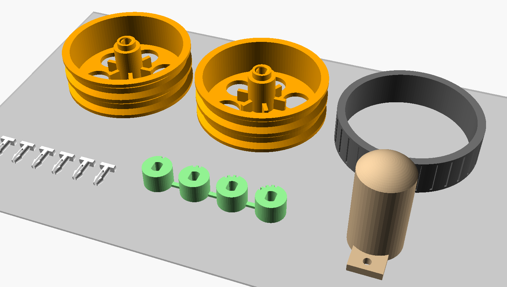

# 3D-printed parts: what to print, what to buy

Which TeleBot parts can be printed reliably to cut cost, which can't, and why.

## Summary

Most of the money goes on electronics (ESP32-CAM, cell, motors, driver,
charger board), and none of that can be printed. The chassis was already
printed in the first design. On top of that, printing three more kinds of
part takes the required parts from **$23.78 to $21.78** (about 8 %), for
roughly 26 g of extra filament:

| Bought part | Printed replacement | File | Saves |
|---|---|---|---|
| 2 x TT motor **with wheel** ($2.00 each) | 2 x printed wheel on bare TT motors ($1.30 each) + 4 O-rings ($0.20) | `wheel.scad` | $1.20 |
| M3 screws and nuts ($0.80) | 6 snap-in push pins (4 used, 2 spare) | `push_pin.scad` | $0.80 |
| Caster ball ($0.30), **hard floors only** | Domed skid | `caster_skid.scad` | $0.30 (optional) |

Two helper prints come with these:

| Print | File | Why |
|---|---|---|
| Shaft fit test | `shaft_fit_test.scad` | 4 hubs with bore clearances from 0.05 to 0.20 mm. Print it before the wheels: TT shafts and printers both vary |
| TPU tire (optional) | `tire_tpu.scad` | For people who already have TPU. Grips less than an O-ring (see research below) |

The parts that were already printed replace a bought chassis plate, motor
brackets, a ball-caster housing and a camera mount:

| Already printed | File | Replaces |
|---|---|---|
| Deck with motor saddles and caster post | `chassis_base.scad` | Acrylic 2WD chassis plate, motor brackets |
| Caster holder | `caster_holder.scad` | Metal ball caster (~$0.50-1.00) |
| Camera bracket | `esp32cam_bracket.scad` | Camera mount / case |

## The new parts

### Wheel (`wheel.scad`)

* 65 mm overall with tires, so the ride height and the caster still match
  the chassis.
* PLA or PETG hub with a double-D bore for the TT shaft (5.4 mm round,
  3.7 mm across the flats, plus `shaft_clr` per side), a 0.6 mm lead-in
  chamfer, and a 3 mm spacer that keeps the rim off the gearbox.
* Two grooves with 45° flanks for **55 x 3.5 mm NBR O-rings**. The flanks
  print without supports, and the O-rings sit 1.3 mm proud of the rim, so
  only rubber touches the floor. The groove floor is sized for about 5 %
  stretch (55 mm ID on a 58.2 mm groove).
* `tire = "tpu"` swaps the grooves for one channel with retaining lips for
  `tire_tpu.scad`.
* Optional M2 self-tapping screw into the shaft's centre hole
  (`screw_hole = true`). It holds the wheel on if the push fit is loose.
* Prints outer face down, no supports, about 12 g. Print two.

**Fit procedure:** print `shaft_fit_test.scad` (2 g, about 10 minutes) with
the same filament and settings. Push each hub onto a motor shaft; the notches
count the clearance (1 = 0.05 mm ... 4 = 0.20 mm). Set `shaft_clr` in
`lib/telebot_common.scad` to the tightest hub that goes fully on by hand,
then run `make stl` and print the wheels.

### Push pins (`push_pin.scad`)

* Replace all four M3 screws and both nuts: two pins hold the camera bracket
  and two hold the caster holder (or skid). The holes are the same M3
  clearance holes, so screws still work if you prefer them.
* Split shank 3.2 mm in a 3.4 mm hole, barbs 4.0 mm, grip 6.5 mm (3 mm deck
  plus the 3.5 mm bracket foot or caster flange).
* Printed **lying flat**, so the prongs bend within a layer instead of
  across layer lines. The prongs only deflect 0.3 mm each when inserted,
  about 1 % strain, well inside what PLA and PETG take repeatedly.
* Loads are tiny: the caster pushes *up* into the deck while driving, and the
  pins only keep it from dropping when the robot is lifted.
* PETG preferred, PLA works. Print at 0.12-0.16 mm layers, 100 % infill.
  Remove a pin by squeezing the prongs from below.

### Caster skid (`caster_skid.scad`), optional

* Same flange, post bore and pins as the ball caster, with a 14 mm-radius
  dome that touches the floor at the same height as the ball.
* Fine on wood, tile and laminate; it drags on carpet and rugs, so keep the
  ball caster there. Sand the dome smooth; a little silicone or PTFE dry lube
  helps.

## Cost after printing

| | First design | With printed wheels and pins |
|---|---|---|
| Required parts ([bom.csv](bom.csv)) | $23.78 | **$21.78** |
| ...with the skid instead of the ball | | $21.48 |
| Filament | ~$2.00 (estimated 95 g) | ~$2.00 (measured ~88 g + waste) |

Measured from the STLs (solid volume x 60 % for a 3-wall, 25-30 % infill
print, PLA): base 47 g, each wheel 12 g, caster holder 6 g, camera bracket
7 g, skid 8 g, pins 0.4 g, fit test 3 g, TPU tire 13 g (100 % infill).

One saving that has nothing to do with printing: if you already own a 3.3 V
USB-serial adapter, buy the ESP32-CAM without the ESP32-CAM-MB board
(about $5.50 instead of $7.50).

## Not worth printing

| Part | Why it stays bought |
|---|---|
| **Motor gearboxes** | A bare 130 motor plus a printed 1:48 reduction would save under $1 per motor, but needs metal axles, several gear stages and assembly. Builders report printed PLA gears running long at low torque, but the motor pinion is the usual weak point and stalls strip teeth; a drive motor stalls every time the robot bumps a wall. The moulded TT gearbox is already the cheapest reliable reduction |
| **Battery holder and contacts** | The print can only be the carrier: the contacts must be metal (nickel strip, springs, leaf contacts), and builders of printed 18650 holders report contacts that lose connection, which on this robot means brown-out resets. A bought holder is $0.40 and is the robot's only power path |
| **Caster ball** | FDM spheres are neither round nor smooth. A glass marble costs $0.30 or nothing; the skid covers hard floors |
| **Tires in PLA or PETG** | No grip on smooth floors; the wheels spin and the robot skids. Use O-rings, rubber bands or TPU |
| **ESP32-CAM clip without headers** | It would have to grip the board edges, and what sits near those edges varies between ESP32-CAM clones. The $0.20 stacking headers also let you pull the board out for USB flashing |
| **Module brackets for the driver and charger** | Foam tape ($0.20) is simpler and absorbs vibration |
| **Switch, connectors, anything electrical** | Need metal contacts |

## Research notes

What the published builds and guides say, and how it shaped these parts:

* **TT shaft fit varies; test-print it.** Commercial TT hubs are made to
  grip the double-D shaft tightly
  ([Adafruit snap-on hub](https://core-electronics.com.au/snap-on-hub-for-tt-motor.html.plain.md)).
  Student builds of printed hubs needed several iterations: one first print
  was too exact and needed a looser fit
  ([WCU hub project](https://portfolio.wcu.edu/jlconnole1/?p=474)). This is
  why the bore clearance is a parameter with a test coupon, and why the hub
  is rigid PLA/PETG, as a published TPU TT wheel also recommends
  ([MakerWorld TPU wheel for TT motors](https://makerworld.com/models/2988300);
  [Printables TT motor wheel](https://www.printables.com/model/859536-tt-motor-wheel)).
* **PLA has no grip; printed TPU is only a bit better.** Builders report PLA
  wheels are "very slippery" and skid
  ([Fab Academy omniwheels](https://fabacademy.org/2022/labs/singapore/students/bryan-tee/projects/04-omniwheels/)).
  Printed 95A TPU grips much less than soft commercial or cast tires; one
  builder switched to cast tires for that reason
  ([3D-printed molds for small robot wheels](https://eleccelerator.com/3d-printed-molds-for-small-robot-wheels/)),
  and O-rings are a common choice on printed wheels
  ([V1 Engineering forum, rolling plotter](https://forum.v1e.com/t/rolling-plotter-build/15389?page=6)).
  Hence O-rings by default and TPU as an option.
* **Printed battery holders need real contacts.** Guides treat the print
  as a mechanical carrier only
  ([Fab Academy DIY battery holders](https://fabacademy.org/2020/labs/incitefocus/students/daniel-meyer/projects/BatteryHolders/)),
  builders report contact problems with printed 18650 holders
  ([Hackaday 18650 holders](https://hackaday.io/project/188444-18650-holders);
  [Endless Sphere](https://endless-sphere.com/sphere/threads/generic-plastic-case-housing-for-three-vertical-18650s-in-a-triangle.126851)),
  and printed flexures can replace the spring but not the metal
  ([flexing battery holders](https://jpralves.net/post/2015/06/02/flexing-battery-holders-with-integrated-spring.html)).
* **Printed gearboxes work at low torque, fail at stall.** Printed 130-motor
  gearboxes exist; one designer suggests oiling PLA gears to make them last
  ([Printables DC130 gearbox](https://www.printables.com/model/1568497-dc130-motor-gearbox-housing-modular-remix-friendly);
  [MakerWorld 130 gearbox](https://makerworld.com/models/2221197)). Build
  reports describe PLA gears lasting at low torque, with the motor pinion
  as the part that breaks under high load and teeth stripping when the
  motor is too strong for the gears
  ([AZ3D printed gearbox](https://az3d.odoo.com/blog/3d-printing-and-3d-modelling-1/building-a-fully-3d-printed-gearbox-for-a-shredder-with-surprising-torque-19);
  [esk8.news printed gear drive](https://forum.esk8.news/t/fully-3d-printed-gear-drive-that-might-not-suck/4801?page=2)).
  Printed PLA gearboxes are being studied as metal replacements for small
  robot arms ([2022 study](https://web.uni-miskolc.hu/dms/docs/DMS_vol12_nr1_2022/04_Hrdlicka.pdf)),
  but no source tests one in a TT-sized drive.

None of the referenced designs is copied here; the parts are new OpenSCAD
designs sized to this chassis.

## Print list

| Part | File | Qty | Material | Orientation | Layer / infill |
|---|---|---|---|---|---|
| Base | `chassis_base.scad` | 1 | PLA or PETG | top face down (as exported) | 0.2 mm, 3 walls, 25 % |
| Caster holder **or** skid | `caster_holder.scad` / `caster_skid.scad` | 1 | PLA or PETG | flange down | 0.2 mm, 3 walls, 25 % |
| Camera bracket | `esp32cam_bracket.scad` | 1 | PLA or PETG | foot down | 0.2 mm, 3 walls, 25 % |
| Shaft fit test | `shaft_fit_test.scad` | 1 | same as the wheels | as exported | same as the wheels |
| Wheel | `wheel.scad` | 2 | PLA or PETG | outer face down | 0.2 mm, 3 walls, 30 % |
| Push pins | `push_pin.scad` | 1 plate (6 pins) | PETG (or PLA) | flat | 0.12-0.16 mm, 100 % |
| TPU tire (optional) | `tire_tpu.scad` | 2 | 95A TPU | flat | 0.2 mm, 100 %, 20-25 mm/s |

All parts print without supports. STLs are in `chassis/stl/`; `make stl`
regenerates them after you change a parameter.
